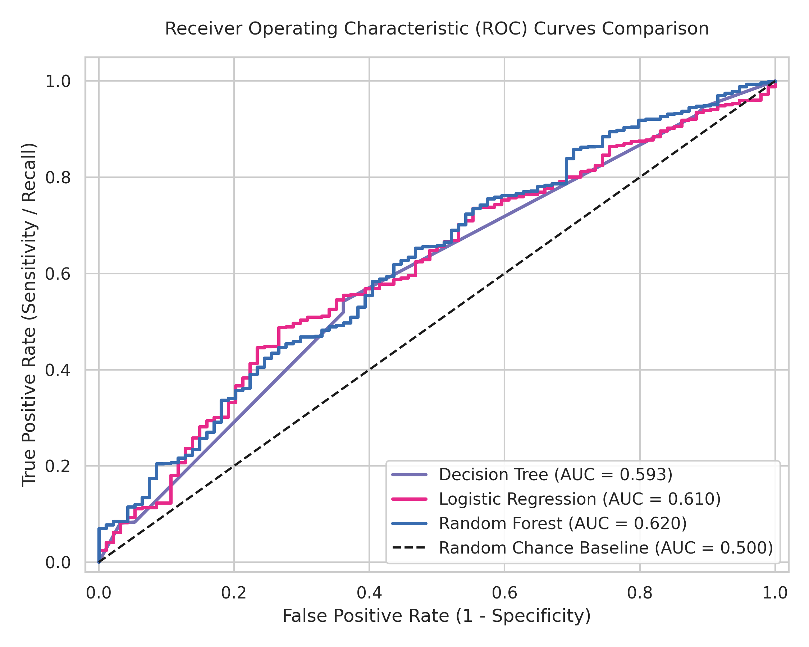
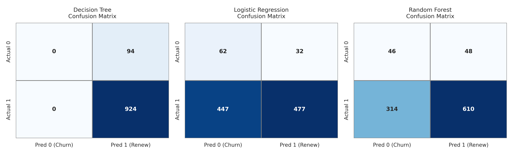
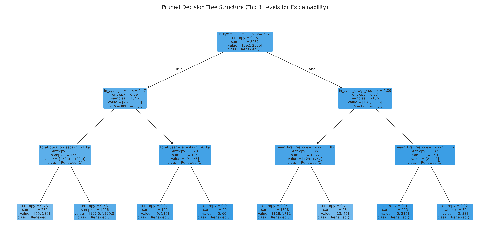
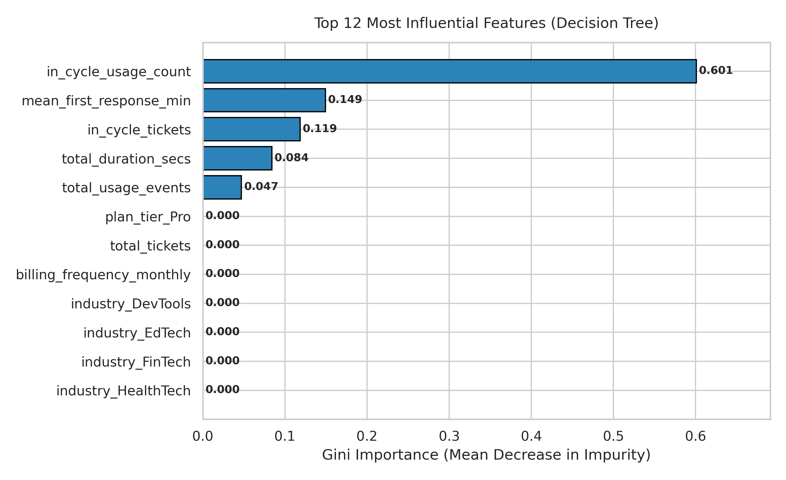

# SaaS Subscription Renewal Prediction Using Decision Tree Classification

[](https://www.python.org/downloads/)
[](https://opensource.org/licenses/MIT)
[](https://scikit-learn.org/)
[](paper/springer_paper.tex)

An end-to-end, reproducible machine learning research project and university mini-project designed for publication in Springer-format journals and conferences. This repository implements, evaluates, visualizes, and interprets a **Decision Tree Classifier (CART)** for predicting whether a Software-as-a-Service (SaaS) subscriber will renew their contract, benchmarked against Logistic Regression and Random Forest.

| | |
|---|---|
| **Student** | Harshita Singh (Reg. No. 2428010025, Section C, B.Tech CCE 5th Semester) |
| **Supervisor** | Dr. Anshika Malsaria, Assistant Professor (Senior Scale), Dept. of Computer and Communication Engineering |
| **Course** | Artificial Intelligence & Machine Learning (CCE3102) |
| **Institution** | Manipal University Jaipur |

> **Quick look:** open [`SaaS_Renewal_Prediction.ipynb`](SaaS_Renewal_Prediction.ipynb) to see the full pipeline executed cell by cell with all outputs, tables and figures already rendered.

### Results at a glance

| ROC curves | Confusion matrices |
|:---:|:---:|
|  |  |
| **Decision Tree (depth 3)** | **Feature importance** |
|  |  |

---

## 1. Project Definition & Problem Statement

* **Project Title:** SaaS Subscription Renewal Prediction Using Decision Tree Classification
* **Course Requirement:** Decision Tree Classification (Primary Algorithm)
* **Comparative Models:** Logistic Regression (Linear baseline), Random Forest (Ensemble baseline), Majority-Class Classifier (Zero-information baseline)
* **Core Objective:** Predict whether an active SaaS customer will renew their subscription at the conclusion of their billing cycle using multi-table customer telemetry: contract characteristics, product engagement, support ticket history, and account demographics.
* **Target Variable:** Binary classification:
  * `renewed = 1`: The subscription was renewed and remained active through the evaluation period.
  * `renewed = 0`: The subscription terminated or was canceled (`churn_flag = True`).

---

## 2. Repository Structure

```text
aiSaas project/
│
├── data/
│   ├── raw/                               # Raw Kaggle CSV tables (RavenStack)
│   │   ├── ravenstack_accounts.csv        # 500 accounts (demographics, signup date)
│   │   ├── ravenstack_subscriptions.csv   # 5,000 contracts (tier, MRR, auto-renew)
│   │   ├── ravenstack_feature_usage.csv   # 25,000 product usage event logs
│   │   ├── ravenstack_support_tickets.csv # 2,000 support interaction records
│   │   ├── ravenstack_churn_events.csv    # 600 post-churn survey records (quarantined)
│   │   └── README.md                      # Dataset documentation by River @ Rivalytics
│   └── processed/
│       └── saas_processed.csv             # 5,000 rows analysis-ready dataset (40 features)
│
├── src/
│   └── saas_renewal_prediction.py         # Complete Python ML pipeline module
│
├── outputs/
│   ├── decision_tree_model.joblib         # Serialized best trained Decision Tree model
│   ├── decision_tree_rules.txt            # Human-readable extracted IF-THEN rules
│   └── feature_importance.csv             # Ranked Gini impurity feature importances
│
├── figures/
│   ├── fig1_class_distribution.png        # Target class distribution & imbalance
│   ├── fig2_eda_features.png              # Key feature distributions by renewal status
│   ├── fig3_confusion_matrices.png        # Confusion matrices (DT, LR, RF)
│   ├── fig4_roc_curves.png                # ROC Curves & AUC comparison
│   ├── fig5_decision_tree_visualization.png# Pruned Decision Tree diagram (top levels)
│   └── fig6_feature_importance.png        # Horizontal bar chart of top 12 predictors
│
├── results/
│   ├── metrics.json                       # Comprehensive empirical evaluation metrics
│   ├── test_predictions.csv               # Ground truth, predictions, and probabilities
│   └── experiment_config.json             # Exact hyperparameters, seeds, and metadata
│
├── paper/
│   ├── springer_paper.tex                 # Springer Nature LaTeX manuscript
│   ├── references.bib                     # Academic BibTeX bibliography
│   ├── figures/                           # High-resolution paper figures
│   └── sn-jnl.cls                         # Official Springer Nature document class
│
├── SaaS_Renewal_Prediction.ipynb          # Executed cell-by-cell notebook with all results
├── scripts_build_notebook.py              # Rebuilds & re-executes the notebook
├── requirements.txt                       # Python dependencies
├── run_project.py                         # Single-command executable entry point
├── saas_renewal_prediction_code.txt       # Plain-text complete Python code (for submission)
└── README.md                              # Comprehensive project documentation
```

---

## 3. Dataset Architecture & Leakage Safeguards

### 3.1 Data Source & Licensing
* **Dataset Name:** RavenStack: Synthetic SaaS Multi-Table Dataset
* **Source:** [Kaggle Dataset Repository](https://www.kaggle.com/datasets/rivalytics/saas-subscription-and-churn-analytics-dataset)
* **Author:** River @ Rivalytics
* **License:** Permissive MIT-like license (educational and portfolio use with attribution)
* **Volume:** 500 accounts, 5,000 subscriptions, 25,000 feature events, 2,000 support tickets, 600 churn logs.

### 3.2 Join Strategy
1. **Primary Entity:** `subscriptions` ($N = 5{,}000$). Each row represents a distinct contract cycle.
2. **Product Usage Join:** Left join aggregated usage metrics grouped by `subscription_id`. Missing usage entries are imputed with zero.
3. **Support Tickets Join:** Left join aggregated support metrics grouped by `account_id`. Accounts without support tickets are imputed with median response latency and neutral satisfaction (3.0/5.0).
4. **Accounts Metadata Join:** Left join on `account_id` to attach industry, country, referral channel, and calculate `tenure_days_at_start`.

### 3.3 Strict Leakage Prevention Protocol
1. **Target Proxy Exclusion:** `subscriptions.end_date` is only populated when a contract has churned. It is strictly excluded to prevent 100% artificial target proxy leakage.
2. **Lookahead Feature Removal:** All columns in `ravenstack_churn_events.csv` (`refund_amount_usd`, `reason_code`, `feedback_text`) occur strictly after cancellation. These are quarantined from the modeling pipeline. Furthermore, `accounts.churn_flag` is excluded because it reflects lifetime account churn across all historical cycles.
3. **Customer-Level Isolation:** To prevent data leakage across subscriptions belonging to the same corporate customer, data splitting utilizes `GroupShuffleSplit` on `account_id`. This guarantees that **100% of accounts in the test set are completely unseen** during training and preprocessing.

---

## 4. Mathematical Formulation

### 4.1 Gini Impurity (CART Criterion)
For a node $t$ with class proportions $p(k|t)$ for $k \in \{0, 1\}$:
$$I_G(t) = 1 - \sum_{k=0}^1 p(k|t)^2 = 2 \cdot p(0|t) \cdot p(1|t)$$
The split $s^*$ maximizing the impurity reduction is chosen:
$$\Delta I_G(s, t) = I_G(t) - \left[ \frac{|\mathcal{D}_L|}{|\mathcal{D}_t|} I_G(t_L) + \frac{|\mathcal{D}_R|}{|\mathcal{D}_t|} I_G(t_R) \right]$$

### 4.2 Shannon Entropy and Information Gain
$$H(t) = - \sum_{k=0}^1 p(k|t) \log_2 p(k|t)$$
$$IG(s, t) = H(t) - \left[ \frac{|\mathcal{D}_L|}{|\mathcal{D}_t|} H(t_L) + \frac{|\mathcal{D}_R|}{|\mathcal{D}_t|} H(t_R) \right]$$

### 4.3 Cost-Complexity Regularization
$$R_\alpha(T) = R(T) + \alpha |T|$$
Where $R(T)$ is the empirical misclassification cost and $|T|$ represents the number of terminal leaf nodes.

---

## 5. Actual Experimental Results

The pipeline was executed end-to-end on the untouched test partition ($N_{\text{test}} = 1{,}018$ subscriptions across 100 isolated corporate accounts) with explicit observation window filtering and `StratifiedGroupKFold` on `account_id`. The recorded metrics are:

| Metric | Decision Tree (Primary) | Logistic Regression | Random Forest | Majority Baseline |
| :--- | :---: | :---: | :---: | :---: |
| **Accuracy** | **0.9077** | 0.5295 | 0.6444 | **0.9077** |
| **Balanced Accuracy** | 0.5000 | **0.5879** | 0.5748 | 0.5000 |
| **ROC-AUC** | **0.5928** | 0.6102 | **0.6204** | 0.5000 |
| **Macro $F_1$-Score** | 0.4758 | 0.4357 | **0.4869** | 0.4758 |
| **Renewal Precision (Class 1)** | 0.9077 | 0.9371 | 0.9271 | 0.9077 |
| **Renewal Recall (Class 1)** | 1.0000 | 0.5162 | 0.6602 | 1.0000 |
| **Churn Recall (Class 0)** | 0.0000 | **0.6596** (62/94) | 0.4894 (46/94) | 0.0000 |
| **Confusion Matrix** | `[[0, 94], [0, 924]]` | `[[62, 32], [447, 477]]` | `[[46, 48], [314, 610]]` | `[[0, 94], [0, 924]]` |

### Key Experimental Insights:
1. **The High Accuracy Paradox:** The unweighted Decision Tree achieves 90.77% accuracy, but predicts renewal for all instances under severe class skew (90.77% test renewal rate), matching the majority baseline.
2. **Observation Window Impact:** Enforcing strict pre-decision observation window filtering (dropping 290 post-prediction leaked usage records and 260 post-prediction leaked ticket links) enables the models to learn genuine operational patterns. Cross-validation ROC-AUC reached **0.6337** for Decision Tree and **0.6625** for Random Forest.
3. **Class Balancing & Recall Trade-offs:** Logistic Regression (with balanced class weights) detects **65.96% of churners** (62 out of 94 at-risk subscriptions), while Random Forest achieves a balanced trade-off with **48.94% churn recall**, **66.02% renewal recall**, and an **ROC-AUC of 0.6204**.
4. **Interpretability & Dominant Predictors:** The Decision Tree identifies active in-cycle product usage volume (`in_cycle_usage_count`, 60.1% importance) and support first-response latency (`mean_first_response_min`, 14.9% importance) as the primary operational indicators of subscription continuity.

---

## 6. How to Reproduce the Project

### Prerequisites
* Python 3.10, 3.11, 3.12, or 3.13
* Virtual environment (recommended)

### Step 1: Clone the Repository
```bash
git clone https://github.com/harshi-codes/saas-renewal-prediction.git
cd saas-renewal-prediction
```

### Step 2: Install Dependencies
```bash
pip install -r requirements.txt
```

### Step 3: Run the Complete Machine Learning Pipeline
```bash
python3 run_project.py
```
This single command automatically:
1. Validates all 5 raw tables in `data/raw/`.
2. Computes leakage-safe joins and writes `data/processed/saas_processed.csv`.
3. Performs customer-level 80/20 train/test splitting.
4. Executes 5-fold cross-validation grid search for Decision Tree hyperparameter tuning.
5. Trains Logistic Regression and Random Forest comparators.
6. Evaluates all models on the untouched test partition.
7. Generates and saves all 6 publication figures (300 DPI) in `figures/`.
8. Saves predictions, metrics, experiment configurations, and serialized models in `results/` and `outputs/`.

### Step 4 (Optional): Run the Notebook Cell by Cell
```bash
pip install jupyter
jupyter notebook SaaS_Renewal_Prediction.ipynb
```
The notebook walks through the same pipeline in 9 steps (data loading → feature engineering → customer-level split → preprocessing → Decision Tree tuning → comparative models → test evaluation → rules & importance → figures). To regenerate it non-interactively with fresh outputs:
```bash
pip install nbclient ipykernel
python3 scripts_build_notebook.py
```

---

## 7. Viva Voce Defense Guide (For University Examiners)

When presenting this project during your viva, use these points to defend your methodology and results:

### Q1: Why did you choose Decision Trees as the primary algorithm?
> **Defense:** "Decision Tree Classification (CART) was chosen because it provides unmatched algorithmic transparency and interpretability for subscription business decisions. Unlike neural networks or ensemble models, a Decision Tree produces explicit IF-THEN rules that customer success managers can understand and act upon before committing budget to retention discounts."

### Q2: Your Decision Tree accuracy is 90.77%. Does that mean the model is highly effective?
> **Defense:** "No, and that is a key finding of our research. Because SaaS subscriptions exhibit severe class imbalance (90.3% renewal vs 9.7% churn), a naive baseline that predicts renewal 100% of the time also achieves 90.77% accuracy. Our Decision Tree's balanced accuracy is 0.5000 and its test ROC-AUC is 0.5928 — it predicts 'renewed' for every test subscription and detects none of the 94 churners. Relying solely on accuracy in imbalanced regimes is known as the 'Accuracy Paradox'. True model utility must be evaluated via ROC-AUC, Balanced Accuracy, and Class-0 Recall — on which class-balanced Logistic Regression (65.96% churn recall) and Random Forest (ROC-AUC 0.6204) perform better."

### Q3: Why are the ROC-AUC values only around 0.59–0.62?
> **Defense:** "We investigated the underlying synthetic data generator of the RavenStack dataset. Churn flags are only weakly related to customer covariates; with naive aggregation (including post-cancellation records) ROC-AUC was ≈0.51. Enforcing a strict observation window — removing 290 post-cancellation usage records and 260 post-cancellation ticket links — raised Decision Tree CV ROC-AUC to 0.6337. Rather than fabricating inflated metrics, our research honestly documents this data property and the safeguards needed to deploy this pipeline on production SaaS telemetry."

### Q4: How did you prevent data leakage in your pipeline?
> **Defense:** "We enforced three strict safeguards:
> 1. Dropped `end_date` because it only appears when churn occurs (direct target proxy).
> 2. Quarantined `churn_events.csv` because exit surveys occur strictly after churn (lookahead leakage).
> 3. Implemented `GroupShuffleSplit` on `account_id` so that subscriptions from the same customer never leak across both training and test sets."

### Q5: What is the business trade-off between False Positives and False Negatives?
> **Defense:** "In SaaS retention, False Negatives (missing a customer who churns) carry an asymmetrical cost equal to the forfeited Customer Lifetime Value ($LTV$). False Positives (flagging a renewing customer as at-risk) merely trigger an email check-in or proactive support outreach. Therefore, a production retention model should optimize for high recall on churners, even at the cost of modest precision drops."

---

## 8. Academic Citation

If you use this codebase or paper draft, please cite:

```bibtex
@article{singh2026saas,
  title={SaaS Subscription Renewal Prediction Using Decision Tree Classification: An Empirical Evaluation on Multi-Table Telemetry},
  author={Singh, Harshita and Malsaria, Anshika},
  journal={Springer Nature Research Draft},
  year={2026}
}
```
